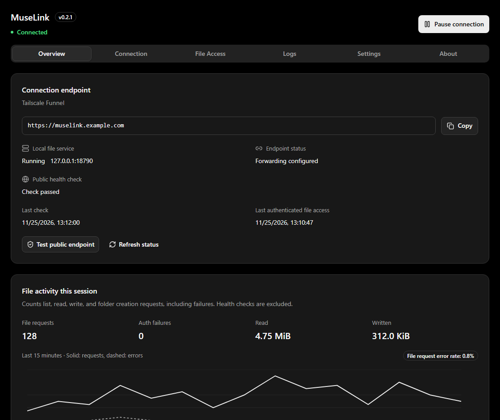
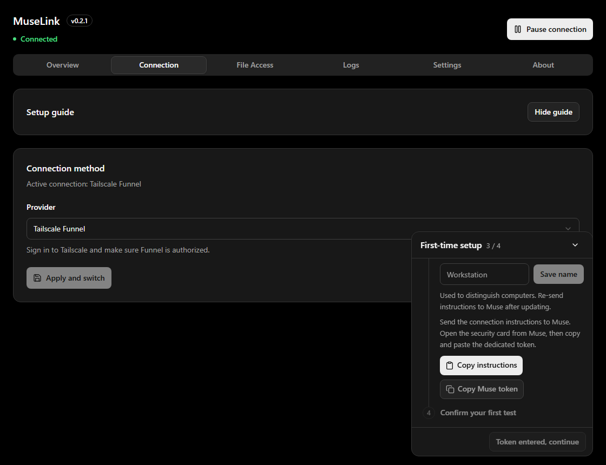
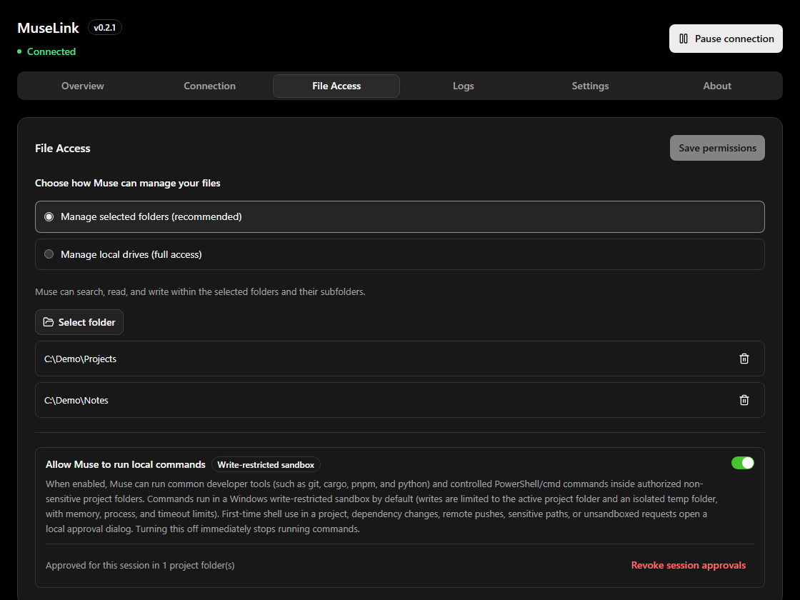
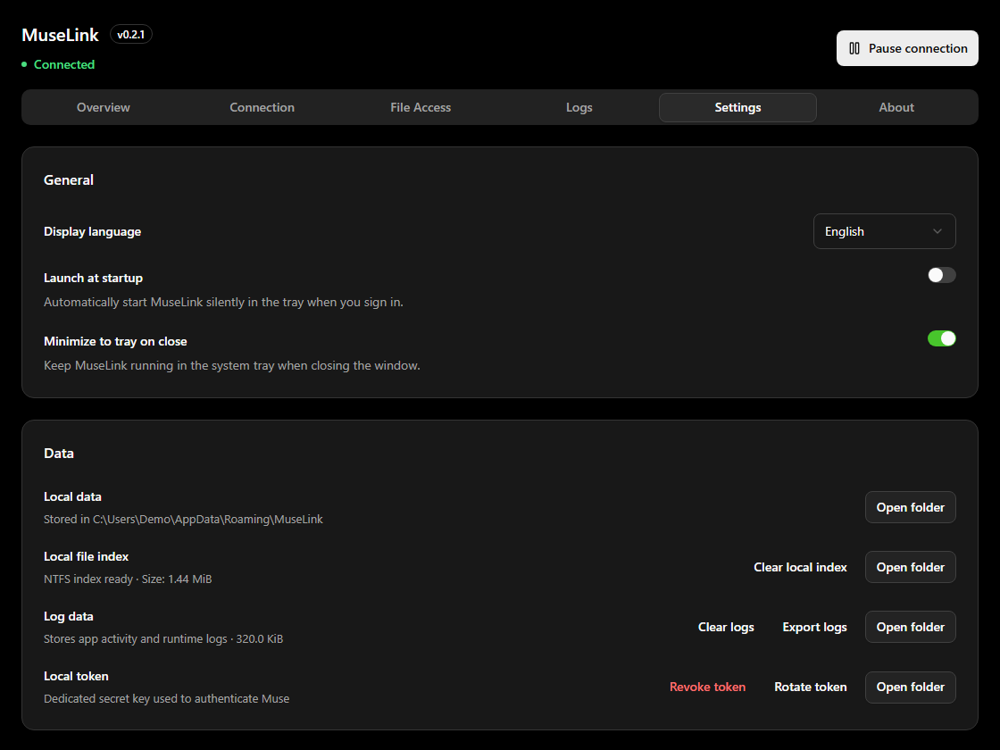

<p align="center">
  
</p>

<h1 align="center">MuseLink — Windows File Connector for Muse</h1>

<p align="center">
  Let Muse search, read, and write files in authorized Windows folders and drives, and optionally run project commands inside a write-restricted sandbox with local approval.
</p>

<p align="center">
  <a href="README.md">简体中文</a> · <a href="README.en.md">English</a> ·
  <a href="https://github.com/Aenvo/MuseLink/releases/latest">Download latest</a> ·
  <a href="#quick-start">Quick start</a> · <a href="#build-from-source">Build from source</a> ·
  <a href="CHANGELOG.en.md">Changelog</a>
</p>

<p align="center">
  
  
  <a href="./LICENSE"></a>
</p>



## App preview

The setup guide in the lower-right corner walks you through granting file access, preparing a public connection, connecting Muse, and testing it for the first time. Return to **File Access** to adjust authorized folders or drives and toggle local command execution, copy connection instructions and the dedicated token under **Connection**, or manage the local file index, logs, and token under **Settings → Data**.

<table>
  <tr>
    <td width="33%" align="center">
      <a href="assets/readme/en/setup-guide.png"></a><br>
      <sub>First-time setup · Connect Muse</sub>
    </td>
    <td width="33%" align="center">
      <a href="assets/readme/en/file-access.png"></a><br>
      <sub>File Access · Permissions &amp; command sandbox</sub>
    </td>
    <td width="33%" align="center">
      <a href="assets/readme/en/settings.png"></a><br>
      <sub>Settings · General &amp; Data</sub>
    </td>
  </tr>
</table>

These screenshots show the MuseLink interface with sample folders, a demo address, and sample file activity.

## Features

| Feature | What it does |
| --- | --- |
| File permissions | Authorize selected folders and their subfolders, or choose from local fixed drives, with built-in protection for credentials and sensitive system paths. |
| Local file tools | Let Muse search by file name, list folders, read files, and write or create folders when needed. |
| Controlled command execution | Off by default; when enabled, lets Muse run developer tools and controlled PowerShell/cmd inside authorized project subfolders under a per-workspace Windows write-restricted sandbox and 3-tier local approval dialog. |
| Public connection | Use Tailscale Funnel by default, or choose a Cloudflare named tunnel with your own domain. |
| Dedicated token | Generate and copy Muse connection instructions and the dedicated token under **Connection**; rotate, revoke, or locate the token under **Settings → Data**, with automatic token redaction in logs. |
| Desktop controls | Filter and search logs by time range, result, scope, and keyword; inspect disk usage, clear or export logs (`JSONL`/`CSV`), and manage the local file index under **Settings → Data**; supports silent launch at startup, configurable minimize-to-tray on close, clean child-process teardown on exit, and English / Simplified Chinese UI. |

## Download and install

Choose a Windows x64 build from [GitHub Releases](https://github.com/Aenvo/MuseLink/releases/latest). Both builds require WebView2.

| Build | Download and launch |
| --- | --- |
| Portable | Download `MuseLink-<version>-windows-x64-portable.zip`, extract the entire archive, and run `muse-connector.exe`. |
| Installer | Download `MuseLink-<version>-windows-x64-setup.exe` and run the installer. |

Use `SHA256SUMS.txt` from the same release to verify your download. The MuseLink executable and installer are unsigned, so Windows may show an unknown publisher prompt.

## Quick start

For the default connection method, install [Tailscale for Windows](https://tailscale.com/download/windows) and sign in.

1. On **Overview** or **Connection**, select **Start guide**.
2. Choose the folders or drives to authorize. All available local fixed drives are selected by default in drive mode. Open the menu to narrow the selection.
3. Generate a Muse token. Follow the guide to authorize Funnel, start the connection, and verify the public endpoint.
4. Save a device name for this computer and send the connection instructions to Muse. Confirm that Muse uses the name to create or update the connector, then paste the token into the security card that Muse sends back.
5. Choose a non-sensitive file within the authorized scope and check the contents Muse returns.

When connecting several computers, give each one a distinct device name, its own connector, and its own token. Ask Muse for the device by name, for example, “Find `hello.txt` on Laptop.” To rename a connected device, save the new name under **Connection**, then copy the rename instructions and paste them into Muse. The pending status clears when Muse sends its confirmation. You can also check the new name in Muse and confirm it manually under **Connection**.

File indexing starts in the background after you first save permissions. Manage local data, file index usage/rebuilds, log cleanup/export, and token rotation/revocation under **Settings → Data**. Configure display language, silent startup launch, and minimize-to-tray on close under **Settings → General**.

## Access and connection boundaries

- **File & sensitive-path protection**: Muse's file operations follow the saved access scope and the current Windows account's permissions. Credential directories (such as `~/.muse-bridge`, `~/.ssh`, `~/.aws`, and `~/.gnupg`) are excluded by default, and system folders, Startup folders, shell profiles, `.gitconfig`, and the app directory are write-protected by default. Reads and atomic writes are verified through open OS handles.
- **Per-workspace write-restricted sandbox**: Local command execution is off by default and can be enabled under **File Access** (re-copy the setup instructions to Muse after enabling). Commands run inside a Windows write-restricted sandbox (`CreateRestrictedToken(WRITE_RESTRICTED)` + `JobObject` memory, process-count, and timeout limits) with a unique SHA-256-derived SID per workspace. Writes are restricted strictly to the targeted project subfolder and an isolated per-job temp directory (bare drive roots are rejected, and sibling or parent folders cannot write into each other). Internal environment variables are stripped, and sandbox initialization fails closed without silently falling back to unsandboxed execution.
- **3-tier risk model & auto-elevated approval dialog**:
  - **Auto-allowed**: Standard read-only and project build/test commands (such as `git status`/`diff`/`log`, `cargo test`/`check`, `pnpm build`, `pytest`) run without interrupting you and return HTTP 200 directly when they finish quickly; pure read-only direct commands skip workspace write ACLs entirely.
  - **Per-project session approval**: First-time `powershell`/`cmd` usage, package installs/updates, or `git push` in a project wakes the MuseLink window to the foreground (120-second timeout defaults to deny) with long-polling via `GET /agent/v1/exec/<job_id>?wait_ms=20000` so Muse receives approvals and outputs immediately without waiting for a manual chat reply. Choose **Allow once** or **Allow project this session** (valid for 4 hours, strictly scoped per folder, revocable anytime via **Revoke session grants** in **File Access**).
  - **Always single confirmation**: Sensitive paths, parent-directory traversal (`..`), force push, recursive/forced deletion, system admin tools, obfuscated scripts, or `unsandboxed` requests always require a single-use approval with session grants disabled.
- **Kill switch, redaction, and clean teardown**: Disabling command execution, pausing the connection, or rotating/revoking the token immediately cancels running commands and pending approvals and terminates child process trees. Audit and runtime logs automatically redact `mfa_` tokens and can be filtered by **Files** or **Command execution**. Exiting MuseLink cleanly tears down managed `Everything.exe`, `cloudflared`, and command child processes via Windows JobObjects.
- **Permission changes & legacy compatibility**: When you first authorize files, Muse can search, read, and write within that scope. Switching to selected folders preserves only the operations covered by your previous grant; switching from folders to drives requires confirming all operations on the selected drives. Legacy read-only File Bridge settings still apply to the legacy API.
- **Tokens & tunnels**: Enter the dedicated token in the Muse security card. Pause the connection or revoke the token to stop access, and update the security card after rotating it. Cloudflare named tunnels require an available domain in your account; update the URL in Muse whenever switching providers changes the public endpoint.

## Build from source

You'll need Windows, WebView2, Node.js 22.12 or later, pnpm, the Rust MSVC toolchain, and Visual Studio C++ Build Tools. Run these commands from the repository root to start development.

```powershell
pnpm -C muse-connector install --frozen-lockfile
pnpm -C muse-connector tauri dev
```

Development mode uses separate local settings and a simulated connection. The following commands build the frontend, run the tests, and make an NSIS installer.

```powershell
pnpm -C muse-connector build
cargo test --manifest-path muse-connector/src-tauri/Cargo.toml --locked
pnpm -C muse-connector tauri build --bundles nsis
```

The installer is written to `muse-connector/src-tauri/target/release/bundle/nsis/`. Run `pnpm -C muse-connector tauri build --no-bundle` to produce just `muse-connector/src-tauri/target/release/muse-connector.exe`.

## Community

This project links to and recognizes the [LINUX DO](https://linux.do/) community, where it is shared and discussed. Public bug reports, compatibility feedback, and feature suggestions are welcome through GitHub Issues.

## License and acknowledgments

MuseLink is open-sourced under the [MIT License](./LICENSE). The legacy file API is based on the [muse-file-bridge](https://github.com/TTNAN/muse-file-bridge) v0.3 protocol. See [THIRD_PARTY_NOTICES.md](./THIRD_PARTY_NOTICES.md) for third-party licenses and bundled binary notices.
