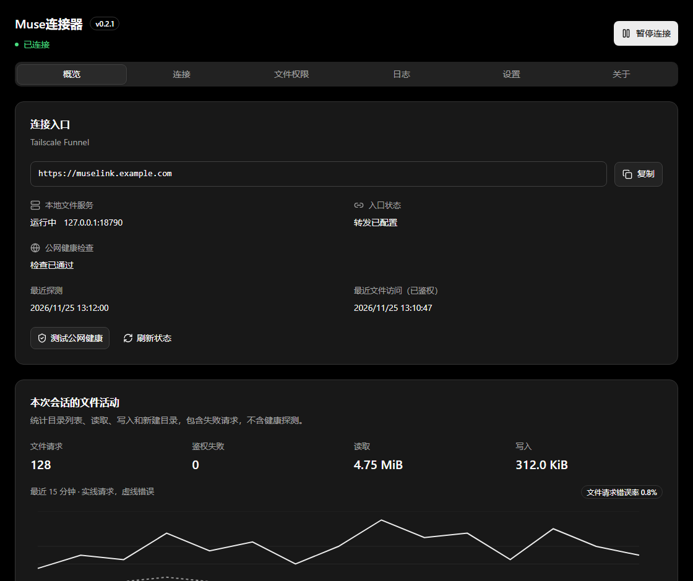
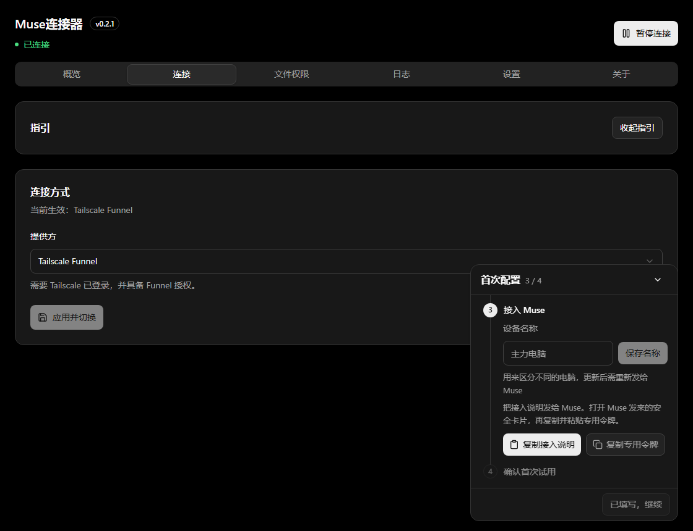
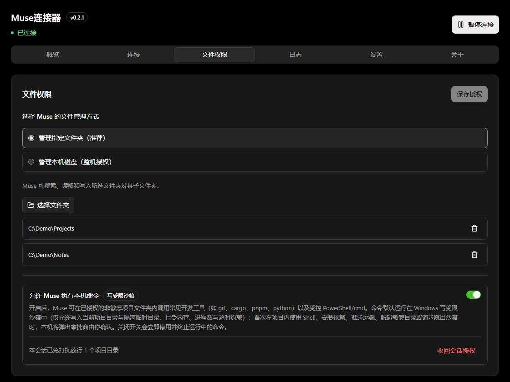
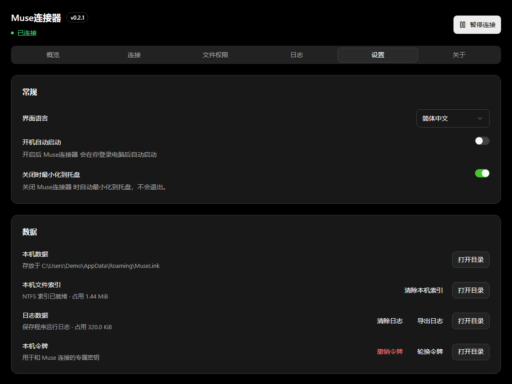

<p align="center">
  
</p>

<h1 align="center">MuseLink · Muse连接器</h1>

<p align="center">
  让 Muse 在你授权的文件夹和磁盘中搜索、读取、写入 Windows 本机文件，并按需在写受限沙箱与本机审批保护下执行项目命令。
</p>

<p align="center">
  <a href="README.md">简体中文</a> · <a href="README.en.md">English</a> ·
  <a href="https://github.com/Aenvo/MuseLink/releases/latest">下载最新版</a> ·
  <a href="#使用指南">使用指南</a> · <a href="#从源码构建">源码构建</a> ·
  <a href="CHANGELOG.md">更新日志</a>
</p>

<p align="center">
  
  
  <a href="./LICENSE"></a>
</p>



## 界面预览

右下角的配置指引会带你完成文件授权、准备公网连接、接入 Muse 和首次试用。之后可以在「文件权限」调整目录或磁盘并按需开关本机命令执行，在「连接」复制接入说明与专用令牌，或在「设置 → 数据」管理本机文件索引、日志和专用令牌。

<table>
  <tr>
    <td width="33%" align="center">
      <a href="assets/readme/zh-cn/setup-guide.png"></a><br>
      <sub>首次配置 · 接入 Muse</sub>
    </td>
    <td width="33%" align="center">
      <a href="assets/readme/zh-cn/file-access.png"></a><br>
      <sub>文件权限 · 授权范围与命令沙箱</sub>
    </td>
    <td width="33%" align="center">
      <a href="assets/readme/zh-cn/settings.png"></a><br>
      <sub>设置 · 常规与数据管理</sub>
    </td>
  </tr>
</table>

截图来自 MuseLink 界面，目录、地址和访问统计均为演示数据。

## 功能概览

| 能力 | 可以做什么 |
| --- | --- |
| 文件授权 | 选择指定文件夹及其子目录，或从本机固定磁盘中选择授权范围，默认保护凭证与敏感系统路径。 |
| 本机文件工具 | 让 Muse 按文件名查找文件、列出目录、读取内容，并按需写入与建目录。 |
| 受控命令执行 | 默认关闭；按需开启后，让 Muse 在授权项目子目录内运行开发工具与受控 PowerShell/cmd，运行于每工作区独立 SID 的 Windows 写受限沙箱与三档审批弹窗下。 |
| 公网连接 | 默认使用 Tailscale Funnel，也支持 Cloudflare 命名隧道（自有域名）。 |
| 专用凭证 | 在「连接」生成并复制 Muse 接入说明与专用令牌，在「设置 → 数据」轮换、撤销或定位令牌文件，日志自动脱敏令牌。 |
| 桌面管理 | 按时间、结果、范围与关键词检索日志，在「设置 → 数据」查看占用、清除/导出（JSONL/CSV）日志与管理本机索引；支持开机静默自启、关闭时最小化到托盘、退出自动回收全部托管子进程，支持简体中文 / English。 |

## 下载与安装

在 [GitHub Releases](https://github.com/Aenvo/MuseLink/releases/latest) 选择 Windows x64 版本。两种版本都需要 WebView2。

| 版本 | 下载与启动 |
| --- | --- |
| 免安装版 | 下载 `MuseLink-<version>-windows-x64-portable.zip`，完整解压后运行 `muse-connector.exe`。 |
| 安装版 | 下载 `MuseLink-<version>-windows-x64-setup.exe`，运行安装程序。 |

可用同一 Release 中的 `SHA256SUMS.txt` 校验下载文件。MuseLink 主程序及安装包尚未进行代码签名，Windows 可能提示未知发布者。

## 使用指南

默认连接方式需要安装 [Tailscale for Windows](https://tailscale.com/download/windows) 并登录。

1. 在「概览」或「连接」点击「开始指引」。
2. 选择要授权的文件夹或磁盘。磁盘模式默认选中所有可用的本机固定磁盘，展开下拉框即可调整。
3. 生成 Muse 专用令牌，按指引授权 Funnel、开启连接并验证公网入口。
4. 保存这台电脑的设备名称，再把接入说明发给 Muse。确认 Muse 使用该名称创建或更新连接器，把专用令牌粘贴到 Muse 发来的安全卡片。
5. 在授权范围内挑一份无敏感内容的文件试读，核对 Muse 返回的内容。

接入多台电脑时，每台电脑使用不同的设备名称、独立的连接器和专用令牌。请在 Muse 中点名要访问的设备，例如「在笔记本上找 `hello.txt`」。在「连接」页可以修改设备名称。已接入的设备改名后，复制改名说明并粘贴给 Muse。收到 Muse 的回执后，待更新状态会自动清除。也可以在 Muse 确认新名称后，回到「连接」页手动确认。

第一次保存授权后，文件索引会在后台建立。在「设置 → 数据」可以查看本机数据、文件索引占用/重建、日志清除与导出以及令牌轮换与撤销。「设置 → 常规」可切换界面语言、开机静默自启及关闭窗口时最小化到托盘。

## 权限与连接边界

- **文件与敏感路径保护**：Muse 的操作受已保存的授权范围和当前 Windows 账户权限约束。默认排除凭证私钥目录（如 `~/.muse-bridge`、`~/.ssh`、`~/.aws`、`~/.gnupg`），并对系统目录、启动项、Shell Profile、`.gitconfig` 与程序自身目录启用默认写保护；文件读取与原子写入通过已校验的内核句柄完成。
- **每工作区独立写受限沙箱**：命令执行默认关闭，可在「文件权限」按需开启（开启后请重新复制接入说明发给 Muse）。命令默认运行在 Windows 写受限沙箱（`CreateRestrictedToken(WRITE_RESTRICTED)` + `JobObject` 内存/进程数/超时硬限制）中，按工作区路径派生独立 SID，仅允许写入当次指定的具体项目子目录与单任务隔离临时目录（禁止直接对盘符根目录执行，不同项目与父子目录之间互不可写），且剥离内部环境变量、失败即拒（绝不静默降级无沙箱）。
- **三档风险分流与本机置顶审批**：
  - **自动放行**：项目内常见只读与标准开发构建/测试命令（如 `git status`/`diff`/`log`、`cargo test`/`check`、`pnpm build`、`pytest` 等），快速命令在短等待内直接返回 HTTP 200 与完整输出；纯只读直调命令不触碰工作区写权限。
  - **项目会话免打扰**：首次在某项目目录内使用 `powershell`/`cmd`、安装/变更依赖或 `git push` 时，自动唤醒并临时置顶本机审批窗（120 秒未确认自动拒绝），支持通过 `GET /agent/v1/exec/<job_id>?wait_ms=20000` 长轮询实时感知审批与执行结果（无需回到聊天手动回复），可选择「仅允许这一次」或「本次会话允许该项目」（4 小时有效、按目录严格隔离，可在「文件权限 → 收回会话授权」一键撤销）。
  - **强制单次确认**：触碰敏感目录、命令含跨目录路径（`..`）、强制推送、递归/强制删除、系统管理工具、混淆脚本或显式请求 `unsandboxed` 时，始终要求单次确认，不提供会话免打扰。
- **紧急中止与审计清理**：关闭命令执行开关、暂停连接、轮换或撤销令牌时，会立即中止全部运行中命令与待审批请求并强杀进程树；审计与运行日志自动脱敏 `mfa_` 专用令牌，支持在「日志」页按「文件」「命令执行」筛选；应用退出时通过 Windows JobObject 自动回收托管的 `Everything.exe`、`cloudflared` 与命令子进程。
- **权限切换与旧版兼容**：首次保存文件授权时，Muse 默认可搜索、读取和写入所选范围。切换到指定文件夹时，只保留原授权范围覆盖的操作；从文件夹切换到磁盘时，需要确认对所选磁盘启用全部操作。旧版 File Bridge 的只读配置仍适用于旧接口。
- **连接与令牌管理**：把专用令牌填进 Muse 的安全卡片。需要停止访问时，可以暂停连接或撤销令牌；轮换后需要在安全卡片里更新令牌。Cloudflare 命名隧道需要账户下的可用域名，切换提供方导致公网地址变化时需更新 Muse 中的连接地址。

## 从源码构建

准备 Windows、WebView2、Node.js 22.12 或更新版本、pnpm、Rust MSVC 工具链与 Visual Studio C++ Build Tools。在仓库根目录运行下面的命令启动开发环境。

```powershell
pnpm -C muse-connector install --frozen-lockfile
pnpm -C muse-connector tauri dev
```

开发模式使用独立的本机配置与模拟连接。以下命令用于构建前端、运行测试和生成 NSIS 安装包。

```powershell
pnpm -C muse-connector build
cargo test --manifest-path muse-connector/src-tauri/Cargo.toml --locked
pnpm -C muse-connector tauri build --bundles nsis
```

安装包输出在 `muse-connector/src-tauri/target/release/bundle/nsis/`。如只需 EXE，运行 `pnpm -C muse-connector tauri build --no-bundle`，输出为 `muse-connector/src-tauri/target/release/muse-connector.exe`。

## 社区

本项目链接认可 [LINUX DO](https://linux.do/) 社区，并在社区分享与交流。欢迎通过 GitHub Issues 提交可公开的问题、兼容性反馈和功能建议。

## 许可证与致谢

本项目采用 [MIT License](./LICENSE) 开源。旧版文件接口基于 [muse-file-bridge](https://github.com/TTNAN/muse-file-bridge) v0.3 协议；第三方许可与随包组件声明见 [THIRD_PARTY_NOTICES.md](./THIRD_PARTY_NOTICES.md)。
